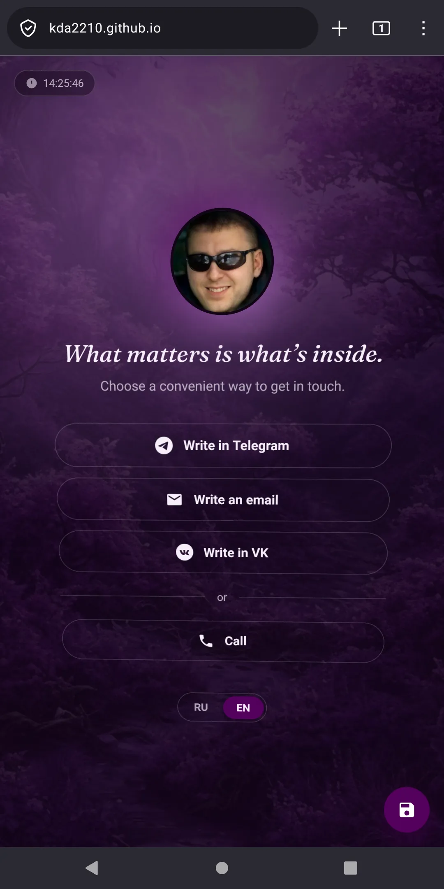
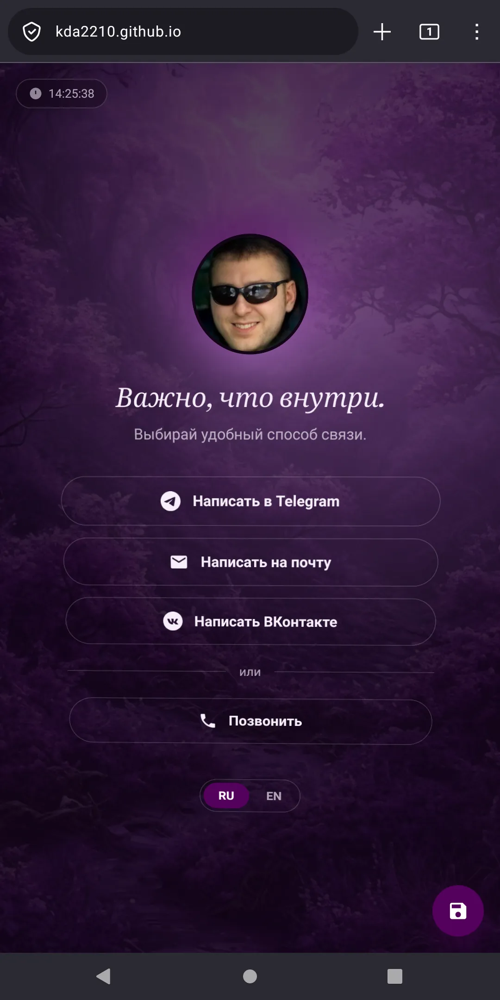

<p align="right"><a href="#en-top"><b>🇬🇧 English</b></a> · <a href="#ru-top">🇷🇺 Русский</a></p>

# 🪪 kda2210.github.io

---

<a name="en-top"></a>
# 🇬🇧 English

*A personal digital business card in one HTML file, with more attention to detail than you might expect.*

<p align="center">
<a href="#en-about">📖 About</a> ·
<a href="#en-try">🔗 Try it</a> ·
<a href="#en-features">✨ Features</a> ·
<a href="#en-license">📄 License</a> ·
<a href="#en-support"></a> ·
<a href="#en-partners">🏛️ Partners</a> ·
<!-- ROADMAP TOGGLE (nav): delete this comment pair to show the link for a project that has a roadmap
<a href="#en-roadmap">🗺️ Roadmap</a> ·
-->
<a href="#en-contributing">🤝 Contributing</a> ·
<a href="https://github.com/kda2210/kda2210.github.io/issues">🐛 Issues</a> ·
<a href="#ru-top">🇷🇺 RU</a>
</p>

<details>
<summary>📑 Table of contents</summary>

- [About](#en-about)
- [Screenshots](#en-screenshots)
- [Try it](#en-try)
- [Features](#en-features)
- [Built with](#en-built-with)
- [Want to build your own?](#en-fork)
- [Security](#en-security)
- [FAQ](#en-faq)
- [License](#en-license)
- [Support](#en-support)
- [For Organizations & Partners](#en-partners)
<!-- ROADMAP TOGGLE (toc): delete this comment pair to show the entry for a project that has a roadmap
- [Public Roadmap](#en-roadmap)
-->
- 🐛 [Report an issue](https://github.com/kda2210/kda2210.github.io/issues) ↗

</details>

**A personal page doesn't need a framework, a build process, or a long list of dependencies.**

I wanted to see how much I could build in a single HTML file without making the project harder to use or maintain.

> **How much can one HTML file do?**

See for yourself: **[kda2210.github.io](https://kda2210.github.io)**

---

**Free. No ads. No subscriptions. Works offline. Open Source.**

These are the principles I use when building my projects.

This page explains how they shape this site and the way I approach software.

[](LICENSE)
[](https://github.com/kda2210)
[](#en-support)
[](https://kda2210.github.io)


---

## 🌿 Why these principles matter

I want the software I build to remain accessible to everyone. I follow the same principles across my projects, whatever each application is designed to do.

|  | Principle | In short |
|:---:|---|---|
| 💸 | **Free** | You never pay to use it. |
| 🚫 | **No ads** | Nothing competes for your attention. |
| 🔁 | **No subscriptions** | Install once, use it for as long as you like. |
| 📴 | **Works offline** | Core features work without an internet connection. |
| 🔓 | **Open Source** | Nothing hidden. Read it, verify it, build on it. |

<details>
<summary><b>Read the full reasoning behind each principle</b></summary>

### ✔️ Free

You never have to pay to use my apps. Useful tools should be available regardless of someone's financial situation.

### ✔️ No ads

Ads interrupt the task at hand and make an application less pleasant to use. I prefer software that helps with a task without competing for the user's attention.

### ✔️ No subscriptions

For small personal tools, a subscription often feels unnecessary. I want people to be able to install an app and keep using it without taking on another monthly payment.

### ✔️ Works offline

I design my applications so their core features work without an internet connection. That removes the need for a server, improves privacy, and makes the apps usable in more places. *This page is a small exception: the avatar image is loaded from GitHub. Without a connection it still works, with a placeholder icon instead.*

### ✔️ Open Source from day one

I publish each project as open source from the start. You can inspect the code, see how the application works, check for hidden behaviour, suggest improvements, send fixes (see [Contributing](#en-contributing)), or use the code as a starting point for your own work. The code also remains available if I stop maintaining the project.

</details>

<p align="right">(<a href="#en-top">⬆ back to top</a>)</p>

---

<a name="en-about"></a>
## 📖 About

kda2210.github.io is my personal digital business card. It contains an avatar, a short description, and links for getting in touch. The page is a single static HTML file with no build step, frameworks, or libraries. It also has a few details that take more work than the file size suggests: a soft light that follows the cursor or finger and moves slowly when left alone, a card that reacts to the phone's orientation, and a few smaller touches.

I made the page for my own use. I published it so others can see how it works and use the code as a reference if they find it helpful.

---

<a name="en-screenshots"></a>
## 🎬 Screenshots

<details>
<summary><b>📸 Show screenshot</b></summary>
<br>

<p align="center">
  <a href="docs/Screenshot_20260909-142548.webp" target="_blank">
    
  </a>
</p>

<p align="center"><sub>Click the screenshot to open it full size</sub></p>

</details>

---

<a name="en-try"></a>
## 🔗 Try it

Live: **[kda2210.github.io](https://kda2210.github.io)**

To run it locally, clone or download the repository and open `index.html` in a browser. There's nothing to install or build.

---

<a name="en-features"></a>
## ✨ Features

### 🌍 RU / EN

The page remembers your language choice between visits.

---

### 💡 Ambient light

A soft light follows the cursor or your finger. When you stop moving, it slowly drifts on its own.

---

### 📱 Gyroscope on mobile

When you tilt your phone, the background, light, and card respond with a subtle parallax effect.

---

### 📇 Save contact

Creates a vCard in the browser without sending anything to a server.

---

### 🕐 Live clock

Displays the owner's current local time.

---

### ♿ Respects `prefers-reduced-motion`

If your system is set to reduce motion, the animations switch off.

---

### 👀 A hidden easter egg

Not telling. Find it yourself.

---

### 🪶 No libraries or frameworks

The page uses HTML, CSS, and JavaScript in one file, with no libraries to install or update.

<p align="right">(<a href="#en-top">⬆ back to top</a>)</p>

---

<a name="en-built-with"></a>
## 🛠️ Built with

The page is built with HTML, CSS, and JavaScript, without frameworks or build tools. It uses a few browser APIs directly: the Web Audio API for sound and the Device Orientation API for the gyroscope. The animations use CSS custom properties and `@keyframes`. The page loads no external fonts: it uses the fonts already installed on your device.

```
index.html             — the card itself (this page)
supporters/index.html  — the shared Hall of Supporters page
background.webp        — background image (generated by tools/make_background.py)
tools/                 — the script that generates the background image
docs/                  — screenshots used in this README
LICENSE                — GNU GPL v3 or later (source code)
TRADEMARKS.md          — project name, logo and icon policy
SECURITY.md            — how to report a security issue
CONTRIBUTING.md        — how to contribute and the contribution terms
THIRD_PARTY.md         — origin of the icons and trademark notices
.github/FUNDING.yml    — support links shown by GitHub
.github/PULL_REQUEST_TEMPLATE.md — checklist and consent for pull requests
.github/ISSUE_TEMPLATE/ — templates for reporting problems and ideas
```

---

<a name="en-fork"></a>
## 🍴 Want to build your own?

The code is open, so you can create your own version. The main things to change are:

- the Telegram / email / VK / phone links
- the avatar (its URL is also used in `<head>`, for the icons and `og:image`) and the background image
- the project name wherever it appears, and the logo and icon (see the [Trademark Policy](TRADEMARKS.md))
- the timezone in the `TIMEZONE` variable, and the city name in the clock tooltip
- the details in the vCard generator
- the meta tags in `<head>` (title, description, Open Graph, canonical) and the JSON-LD block
- the tagline and the text underneath it

---

<a name="en-security"></a>
## 🔐 Security

If you've found a genuine security issue, please follow the instructions in [SECURITY.md](https://github.com/kda2210/kda2210.github.io/blob/main/SECURITY.md) instead of reporting it in a public issue.

---

<a name="en-faq"></a>
## ❓ FAQ

<details>
<summary><b>Why not React / a static site generator / some build tool?</b></summary>
<br>

A small personal page doesn't need a build pipeline. Keeping it in one file makes the code easier to read, inspect, and reuse.

</details>

<details>
<summary><b>Can I use your photo or contact details if I fork this?</b></summary>
<br>

No — see the note in [License](#en-license). Swap them for your own, that's the whole point of forking it.

</details>

<details>
<summary><b>Does it track or analyze visitors?</b></summary>
<br>

There are no analytics, cookies, or other visitor-tracking tools, and the page doesn't record who opens it. The only thing saved in your browser is your language choice. The only external request is the avatar, which comes from GitHub.

</details>

<details>
<summary><b>What's the easter egg?</b></summary>
<br>

👀

</details>

<p align="right">(<a href="#en-top">⬆ back to top</a>)</p>

---

<a name="en-license"></a>
## 📄 License

Copyright (C) 2026 kda2210 and contributors

This project is free software: you can redistribute it and/or modify it under the terms of the GNU General Public License as published by the Free Software Foundation, either version 3 of the License, or (at your option) any later version. See [LICENSE](LICENSE).

The project name **kda2210.github.io**, its logo and icon are not covered by the GPL. Their use is governed by the [Trademark Policy](TRADEMARKS.md).

The personal content in this repository — including the photo, phone number, email address, social links and the screenshots in [docs/](docs/) that show them — is not part of the licensed source code and is not provided for reuse. If you fork this project, replace these materials with your own. See [Want to build your own?](#en-fork).

The background image is generated by the script in [tools/](tools/), and the icons are original drawings made for this project; both are licensed like the code. Their origin and trademark notices are in [THIRD_PARTY.md](THIRD_PARTY.md).

---

## ❤️ Why I keep building

Building and maintaining applications takes time. I do it because I enjoy making tools that can be useful in everyday life.

If even one of my applications has been useful to you, then all the hours spent building it were worth it. Thank you for using my projects.

---

<a name="en-support"></a>
## ❤️ Voluntary Support

Voluntary contributions help me spend more time improving existing projects and working on new ones. Choose whichever method is most convenient. The amount is up to you, and no amount is too small. Contributions do not unlock features or change how the apps work.

<details>
<summary><b>💳 Show all ways to support</b></summary>

<br>

**One-time — card (Russia)**

<p align="left">
<a href="https://pay.cloudtips.ru/p/89752366"></a>
<a href="https://yoomoney.ru/to/4100119409642062"></a>
</p>

**Ongoing — monthly support**

<p align="left">
<a href="https://boosty.to/kda2210"></a>
</p>

*This is monthly support, not a subscription, and can be stopped at any time.*

**Crypto**

₮ USDT (TRC20)
```text
TJXTxpVagstdhLoZqigZsvyP2CLRzwdgiF
```

₿ Bitcoin
```text
bc1q4p4zesf49zsufnwj3c3ux77fcxzslha4djukwp
```

◈ ETH (ERC20) / USDC (Base) / BNB (BEP20)
```text
0x997250d092b4c2DF645BaA9CA512891f7C3DD351
```

☀️ SOL (Solana)
```text
KidCphzsH8FwNqirSKidVJUEE8ehN8g2WQtNBmuMhPi
```

💎 TON
```text
UQBHfMPQ2zQWno06shSoYWTxZHVl6zGPctfqBnsRQf4r0U4X
```

✕ XRP (Ripple)
```text
r3e3iyezjaGAsB64aNEfGDgrPYmachHZyc
```

★ XLM (Stellar)
```text
GBVZ3TMMJLWJ7RUCM2X6QQZADWHFLHEGDDVOT3TPLVLJFQOCEGVLUCU4
```

**Prefer another method ?**

✉️ kda2210@duck.com

</details>

**[Hall of Supporters](https://kda2210.github.io/supporters)** is a shared thank-you page for my projects. Names are added only with explicit permission. Supporting a project never adds your name automatically.

<p align="right">(<a href="#en-top">⬆ back to top</a>)</p>

---

<a name="en-partners"></a>
## 🏛️ For Organizations & Partners

Everything above is for individuals, and none of it changes here: this project stays 100% free, ad-free, and fully functional for anyone who downloads it. This section doesn't add a paid tier — it just describes a different kind of supporter.

Organizations — companies, foundations, employers, NGOs, schools, research institutions and public bodies — sometimes want to support this work in ways an individual can't, or need to put a project in front of a group of people at once. A few ways that works:

- **Sponsorship credit.** A contribution gets a static "Supported by [name]" line here and on the [Hall of Supporters](https://kda2210.github.io/supporters) — not a banner, not a pop-up, nothing shown inside the app itself.
- **Support agreement.** The project is already free for organizations under the GPL. If you need a written agreement, it can be arranged officially, with a contract and an invoice. It can cover **priority responses** to your questions, **fixes on agreed terms** (priority and timeline), **help with deployment** (installation, configuration, rollout to your people) and **custom changes** made for you. Scope, response times and price are agreed in writing before any work starts, and whether the result is published in the open project is agreed in advance. Each person in your organization still gets the same free, full version, exactly like everyone else.

<details>
<summary><b>Does "free" still apply if my organization is paying?</b></summary>
<br>

Yes. An agreement with an organization pays for support, deployment help and custom work — it never turns a feature on or off for anyone. Every individual gets the exact same free, full version whether they found it themselves or got it through an organization.

</details>

### 🎯 Fund a specific feature

Sponsor a concrete addition — a new language, a specific capability — and get named, permanent credit for it once it ships. It's released free to everyone regardless, same as everything else.

1. You propose a feature — or, if this project keeps a public roadmap, pick one from there.
2. We agree on scope, timeline, and price.
3. You fund it — in full, or split with other sponsors.
4. It ships free for everyone.
5. You get a "Funded by [name]" credit in the changelog and here.

Rough pricing depends on scope — a translation might run a couple hundred dollars, a small feature more, something larger more still. Always discussed and agreed before any work starts, never a fixed price list.

**Currently seeking sponsors**

| Feature | Status |
|---|---|
| _— open slot —_ | _seeking a sponsor_ |

*(This table only lists something once there's a real feature to fund — an honest empty slot beats a made-up percentage.)*

This particular page doesn't have an obvious organizational use case on its own — it's my personal card, not a tool. But it's also the canonical home of these principles, so if you'd rather sponsor the whole lineup of projects instead of one specific tool, this is the right place to reach out.

Interested? **kda2210@duck.com** — put "Partnership" in the subject line.

<p align="right">(<a href="#en-top">⬆ back to top</a>)</p>

---

<!-- ROADMAP TOGGLE (section): delete this comment pair for a project that has a real roadmap to show

<a name="en-roadmap"></a>
## 🗺️ Public Roadmap

*(Per-project: list 2–4 real upcoming features here once there's something concrete, so sponsors have real things to fund. Delete this whole section for a project that doesn't have a roadmap worth showing yet — an empty roadmap looks worse than no roadmap.)*

**Not planned, on principle:**
- Server-side features that would require giving up offline use
- Analytics or tracking of any kind
- Paid tiers or premium features

Want to suggest something? [Open an issue](https://github.com/kda2210/kda2210.github.io/issues).

<p align="right">(<a href="#en-top">⬆ back to top</a>)</p>

---

-->

<a name="en-contributing"></a>
## 🤝 Contributing

Fixes and improvements are welcome.

- Read [CONTRIBUTING.md](CONTRIBUTING.md): how to report a problem, how to run and check the page, and what makes a good pull request.
- Keep the project's principles: no external requests, no tracking, no frameworks or libraries.
- By sending a pull request you agree to the [contribution terms](CONTRIBUTING.md#en-terms). In short: you keep your copyright, the project stays GPL-3.0-or-later for everyone, and I may use your contribution in this and my other projects on any terms, with no obligations to you beyond credit in the git history.

### Contributors

Thank you to everyone who helps develop the project ❤️

[](https://github.com/kda2210/kda2210.github.io/graphs/contributors)

<p align="right">(<a href="#en-top">⬆ back to top</a>)</p>

---

## 🌱 Thank you

Thank you for reading this far.

Whether or not you decide to support these projects, I'm sincerely grateful to everyone who uses them. You're the reason they continue to grow. ❤️

<p align="right"><a href="#ru-top">🇷🇺 Читать на русском ↓</a></p>

---

<a name="ru-top"></a>

# 🇷🇺 Русский

*Личная цифровая визитка в одном HTML-файле. В ней больше внимания к деталям, чем можно ожидать от такой небольшой страницы.*

<p align="center">
<a href="#ru-about">📖 О проекте</a> ·
<a href="#ru-try">🔗 Открыть страницу</a> ·
<a href="#ru-features">✨ Возможности</a> ·
<a href="#ru-license">📄 Лицензия</a> ·
<a href="#ru-support"></a> ·
<a href="#ru-partners">🏛️ Партнёрам</a> ·
<!-- ROADMAP TOGGLE (nav): удалите эту пару комментариев, чтобы показать ссылку для проекта с дорожной картой
<a href="#ru-roadmap">🗺️ Планы</a> ·
-->
<a href="#ru-contributing">🤝 Участие</a> ·
<a href="https://github.com/kda2210/kda2210.github.io/issues">🐛 Сообщить о проблеме</a> ·
<a href="#en-top">🇬🇧 EN</a>
</p>

<details>
<summary>📑 Содержание</summary>

- [О проекте](#ru-about)
- [Скриншоты](#ru-screenshots)
- [Открыть страницу](#ru-try)
- [Возможности](#ru-features)
- [Технологии](#ru-built-with)
- [Как создать свою версию](#ru-fork)
- [Безопасность](#ru-security)
- [Вопросы и ответы](#ru-faq)
- [Лицензия](#ru-license)
- [Поддержка](#ru-support)
- [Организациям и партнёрам](#ru-partners)
<!-- ROADMAP TOGGLE (toc): удалите эту пару комментариев, чтобы показать пункт для проекта с дорожной картой
- [Планы развития](#ru-roadmap)
-->
- 🐛 [Сообщить о проблеме](https://github.com/kda2210/kda2210.github.io/issues) ↗

</details>

**Для личной страницы не обязательно использовать фреймворк, систему сборки и множество сторонних библиотек.**

Я решил проверить, что можно сделать в одном HTML-файле, не усложняя проект без необходимости.

> **Сколько всего может один HTML-файл?**

Посмотреть результат можно здесь: **[kda2210.github.io](https://kda2210.github.io)**

---

**Бесплатно. Без рекламы. Без подписок. Работает без интернета. Открытый исходный код.**

Эти принципы лежат в основе моих проектов. На этой странице я рассказываю о самой визитке и о том, почему выбрал именно такой подход.

[](LICENSE)
[](https://github.com/kda2210)
[](#ru-support)
[](https://kda2210.github.io)


---

## 🌿 Почему я придерживаюсь этих принципов

Я хочу, чтобы полезные программы оставались доступными каждому. Поэтому в своих проектах я придерживаюсь нескольких общих правил — независимо от назначения конкретного приложения.

|  | Принцип | Что это значит |
|:---:|---|---|
| 💸 | **Бесплатно** | За использование не нужно платить. |
| 🚫 | **Без рекламы** | Ничто не отвлекает от работы с приложением. |
| 🔁 | **Без подписок** | Установили один раз и пользуетесь сколько угодно. |
| 📴 | **Работа без интернета** | Основные возможности работают без подключения к интернету. |
| 🔓 | **Открытый исходный код** | Код доступен для просмотра, проверки и доработки. |

<details>
<summary><b>Подробнее о каждом принципе</b></summary>

### ✔️ Бесплатно

За использование моих приложений не нужно платить. Я считаю, что полезные инструменты должны быть доступны независимо от финансовых возможностей человека.

### ✔️ Без рекламы

Реклама отвлекает и мешает сосредоточиться. Мне ближе приложения, которые помогают решить задачу и не борются за внимание пользователя.

### ✔️ Без подписок

Для небольших личных инструментов ежемесячная плата кажется мне лишней. Я хочу, чтобы человек мог установить приложение и пользоваться им без ещё одного регулярного платежа.

### ✔️ Работа без интернета

Основные возможности моих приложений работают без подключения к серверу. Это упрощает работу программы, помогает сохранить конфиденциальность и позволяет пользоваться ею в разных местах. *У этой страницы есть небольшое исключение: аватар загружается с GitHub. Без подключения страница всё равно работает, но вместо него показывается значок-заглушка.*

### ✔️ Открытый исходный код с самого начала

Код каждого проекта доступен с самого начала. Можно разобраться, как устроено приложение, проверить его работу, предложить улучшения, прислать исправления (см. раздел [«Участие в разработке»](#ru-contributing)) или использовать код в качестве основы для своей разработки. Даже если я перестану заниматься проектом, его исходный код останется доступен.

</details>

<p align="right">(<a href="#ru-top">⬆ наверх</a>)</p>

---

<a name="ru-about"></a>
## 📖 О проекте

kda2210.github.io — моя личная цифровая визитка. На ней есть аватар, короткое описание и способы связаться со мной. Вся страница размещена в одном статическом HTML-файле: без этапа сборки, фреймворков и библиотек.

Несмотря на простую основу, в ней есть несколько дополнительных деталей. Мягкое световое пятно следует за курсором или пальцем, а когда его не перемещают — медленно движется само. Карточка реагирует на наклон телефона. Есть и другие небольшие элементы, которые редко встречаются на настолько простых страницах.

Я сделал эту страницу для себя. Потом решил опубликовать её, чтобы другие могли посмотреть, как она устроена, и при желании использовать код в своих проектах.

---

<a name="ru-screenshots"></a>
## 🎬 Скриншоты

<details>
<summary><b>📸 Показать скриншот</b></summary>
<br>

<p align="center">
  <a href="docs/Screenshot_20260909-142540.webp" target="_blank">
    
  </a>
</p>

<p align="center"><sub>Нажмите на изображение, чтобы открыть его полностью</sub></p>

</details>

---

<a name="ru-try"></a>
## 🔗 Открыть страницу

Сайт: **[kda2210.github.io](https://kda2210.github.io)**

Чтобы открыть страницу на своём компьютере, клонируйте или скачайте репозиторий и откройте `index.html` в браузере. Устанавливать и собирать ничего не нужно.

---

<a name="ru-features"></a>
## ✨ Возможности

### 🌍 Русский и английский языки

Переключатель языка запоминает ваш выбор и использует его при следующем посещении.

---

### 💡 Динамическая подсветка

Мягкое световое пятно следует за курсором или пальцем. Когда вы перестаёте двигать ими, подсветка медленно перемещается сама.

---

### 📱 Гироскоп на телефоне

При наклоне телефона меняется положение фона, подсветки и самой карточки. Получается небольшой эффект смещения, для которого не понадобилось много кода.

---

### 📇 Сохранение контакта

Страница создаёт файл контакта в формате vCard прямо в браузере. Сервер для этого не используется.

---

### 🕐 Текущее время

Показывает местное время владельца страницы.

---

### ♿ Учитывает настройку `prefers-reduced-motion`

Если в системе включено уменьшение движения, анимации отключаются.

---

### 👀 Скрытая пасхалка

Не скажу. Найдите сами.

---

### 🪶 Без библиотек и фреймворков

Вся страница написана на HTML, CSS и JavaScript и находится в одном файле. Ничего дополнительно устанавливать, собирать или обновлять не нужно.

<p align="right">(<a href="#ru-top">⬆ наверх</a>)</p>

---

<a name="ru-built-with"></a>
## 🛠️ Используемые технологии

Страница написана на HTML, CSS и JavaScript — без фреймворков и инструментов сборки. Напрямую используются несколько API браузера: Web Audio API для звука и Device Orientation API для работы с гироскопом. Для анимаций применяются пользовательские свойства CSS и `@keyframes`. Внешние шрифты не загружаются: страница использует шрифты, уже установленные на устройстве.

```
index.html             — сама визитка (эта страница)
supporters/index.html  — общая страница «Стена поддержавших»
background.webp        — фоновое изображение (создаётся скриптом tools/make_background.py)
tools/                 — скрипт, который создаёт фоновое изображение
docs/                  — папка со скриншотами для README.md
LICENSE                — GNU GPL версии 3 или более поздней (исходный код)
TRADEMARKS.md          — правила использования названия, логотипа и значка проекта
SECURITY.md            — инструкция по сообщению о проблемах безопасности
CONTRIBUTING.md        — как принять участие и условия участия
THIRD_PARTY.md         — происхождение иконок и уведомления о товарных знаках
.github/FUNDING.yml    — ссылки на поддержку, которые показывает GitHub
.github/PULL_REQUEST_TEMPLATE.md — чек-лист и согласие для pull request
.github/ISSUE_TEMPLATE/ — шаблоны для сообщений о проблемах и идей
```

---

<a name="ru-fork"></a>
## 🍴 Как создать свою версию

Код открыт — вы можете создать копию проекта и изменить её под себя. В первую очередь стоит заменить:

- ссылки на Telegram, почту, VK и номер телефона;
- аватар (его адрес повторяется в `<head>`: значки и `og:image`) и фоновое изображение;
- название проекта везде, где оно встречается, а также логотип и значок (см. [Политику использования торговой марки](TRADEMARKS.md));
- часовой пояс в переменной `TIMEZONE` и название города во всплывающей подсказке часов;
- данные, которые используются при создании файла vCard;
- мета-теги в `<head>` (заголовок, описание, Open Graph, канонический адрес) и блок JSON-LD;
- короткую фразу о владельце и текст под ней.

---

<a name="ru-security"></a>
## 🔐 Безопасность

Если вы нашли настоящую проблему безопасности, действуйте по инструкции в [SECURITY.md](https://github.com/kda2210/kda2210.github.io/blob/main/SECURITY.md) и не сообщайте о ней в открытом обсуждении проекта.

---

<a name="ru-faq"></a>
## ❓ Вопросы и ответы

<details>
<summary><b>Почему не React, генератор статических сайтов или система сборки?</b></summary>
<br>

Для небольшой личной страницы, которую обычно открывают на несколько секунд, сложная сборка не нужна. Один файл проще читать, проверять и брать за основу для собственной версии.

</details>

<details>
<summary><b>Можно ли использовать твою фотографию или контакты в своей копии проекта?</b></summary>
<br>

Нет. Подробнее об этом написано в разделе [«Лицензия»](#ru-license). Замените фотографию и контактные данные своими — для этого и предназначена копия проекта.

</details>

<details>
<summary><b>Страница собирает сведения о посетителях?</b></summary>
<br>

Нет. Здесь нет аналитики, файлов cookie и других средств отслеживания, страница не записывает, кто её открывает. В браузере сохраняется только выбранный язык. Единственный внешний запрос — аватар, он загружается с GitHub.

</details>

<details>
<summary><b>Что за пасхалка?</b></summary>
<br>

👀

</details>

<p align="right">(<a href="#ru-top">⬆ наверх</a>)</p>

---

<a name="ru-license"></a>
## 📄 Лицензия

Copyright (C) 2026 kda2210 and contributors

Исходный код проекта распространяется на условиях GNU General Public License версии 3 либо (по вашему выбору) любой более поздней версии. См. [LICENSE](LICENSE). Полный текст лицензии приведён на английском языке, русский перевод GPL является неофициальным и не заменяет оригинал.

Название проекта **kda2210.github.io**, его логотип и значок не охватываются GPL. Их использование регулируется [Политикой использования торговой марки](TRADEMARKS.md).

Личные материалы в этом репозитории — фотография, номер телефона, адрес электронной почты, ссылки на социальные сети и скриншоты в папке [docs/](docs/), на которых они видны — не входят в лицензируемый исходный код и не предоставляются для повторного использования. При создании своей версии замените их собственными. Подробнее — в разделе [«Как создать свою версию»](#ru-fork).

Фоновое изображение создаётся скриптом из папки [tools/](tools/), а иконки — оригинальные рисунки, сделанные для этого проекта; и то и другое лицензируется так же, как код. Их происхождение и уведомления о товарных знаках приведены в [THIRD_PARTY.md](THIRD_PARTY.md).

---

## ❤️ Почему я продолжаю этим заниматься

Разработка и поддержка таких приложений требуют времени. Я продолжаю этим заниматься, потому что мне нравится создавать полезные инструменты, которые упрощают повседневные задачи.

Если хотя бы одно из моих приложений оказалось вам полезным, значит, время, потраченное на его создание, прошло не зря. Спасибо, что пользуетесь моими проектами.

---

<a name="ru-support"></a>
## ❤️ Добровольная поддержка

Добровольные взносы помогают мне уделять больше времени развитию существующих приложений и работе над новыми. Выберите удобный способ. Сумму выбираете вы, и слишком маленькой она не бывает. Поддержка не открывает дополнительных возможностей и не меняет работу приложений.

<details>
<summary><b>💳 Показать все способы поддержки</b></summary>

<br>

**Разовый перевод с карты (Россия)**

<p align="left">
<a href="https://pay.cloudtips.ru/p/89752366"></a>
<a href="https://yoomoney.ru/to/4100119409642062"></a>
</p>

**Регулярная ежемесячная поддержка**

<p align="left">
<a href="https://boosty.to/kda2210"></a>
</p>

*Это ежемесячная поддержка, а не подписка, её можно прекратить в любой момент.*

**Криптовалюта**

₮ USDT (TRC20)
```text
TJXTxpVagstdhLoZqigZsvyP2CLRzwdgiF
```

₿ Bitcoin
```text
bc1q4p4zesf49zsufnwj3c3ux77fcxzslha4djukwp
```

◈ ETH (ERC20) / USDC (Base) / BNB (BEP20)
```text
0x997250d092b4c2DF645BaA9CA512891f7C3DD351
```

☀️ SOL (Solana)
```text
KidCphzsH8FwNqirSKidVJUEE8ehN8g2WQtNBmuMhPi
```

💎 TON
```text
UQBHfMPQ2zQWno06shSoYWTxZHVl6zGPctfqBnsRQf4r0U4X
```

✕ XRP (Ripple)
```text
r3e3iyezjaGAsB64aNEfGDgrPYmachHZyc
```

★ XLM (Stellar)
```text
GBVZ3TMMJLWJ7RUCM2X6QQZADWHFLHEGDDVOT3TPLVLJFQOCEGVLUCU4
```

**Другой способ ?**

✉️ kda2210@duck.com

</details>

**[Стена поддержавших](https://kda2210.github.io/supporters)** — общая страница благодарности для всех моих проектов. Имя появляется на ней только с согласия самого человека. Сам факт поддержки не добавляет имя автоматически.

<p align="right">(<a href="#ru-top">⬆ наверх</a>)</p>

---

<a name="ru-partners"></a>
## 🏛️ Организациям и партнёрам

Всё, что описано выше, относится к частным пользователям. Для них проект по-прежнему полностью бесплатный, без рекламы и доступен со всеми возможностями. Этот раздел не вводит платную версию — здесь описаны способы, которыми организации могут поддержать разработку.

Компании, фонды, работодатели, некоммерческие организации, образовательные и научные учреждения и государственные органы иногда хотят поддержать проект или предоставить его сразу большой группе людей. Это можно сделать несколькими способами:

- **Упоминание спонсора.** После взноса здесь и на странице [«Стена поддержавших»](https://kda2210.github.io/supporters) появляется строка «Поддержано [название]». Это будет обычный текст — без баннеров, всплывающих окон и рекламы внутри приложения.
- **Договор о поддержке.** Для организаций проект и так бесплатен на условиях GPL. Если вам нужен письменный договор, его можно оформить официально, с договором и счётом. Он может включать **приоритетные ответы** на ваши вопросы, **исправления на согласованных условиях** (приоритет и сроки), **помощь с внедрением** (установка, настройка, раздача сотрудникам) и **доработки** под вас. Объём, сроки ответа и стоимость согласуются письменно до начала работы, а опубликуют ли результат в открытом проекте, договариваются заранее. Каждый человек в вашей организации по-прежнему получает ту же бесплатную полную версию, как и все остальные.

<details>
<summary><b>Остаётся ли проект бесплатным, если платит организация?</b></summary>
<br>

Да. Договор с организацией оплачивает поддержку, помощь с внедрением и доработки; он не включает и не отключает отдельные возможности ни для кого. Каждый человек получает одну и ту же полную бесплатную версию — независимо от того, нашёл он проект самостоятельно или получил его через организацию.

</details>

### 🎯 Финансирование отдельной функции

Можно профинансировать конкретное улучшение — например, добавить новый язык или отдельную возможность. После выпуска ваше участие будет отмечено в проекте. Сама функция при этом останется бесплатной для всех.

1. Вы предлагаете улучшение или выбираете его из опубликованных планов, если они есть у проекта.
2. Мы согласуем объём работы, сроки и стоимость.
3. Вы оплачиваете работу полностью или делите расходы с другими спонсорами.
4. Готовая функция выходит для всех пользователей бесплатно.
5. Ваш вклад отмечается в журнале изменений и на этой странице.

Стоимость зависит от объёма работы. Перевод может обойтись в несколько сотен долларов, небольшое улучшение будет стоить дороже, а крупная доработка — ещё больше. Цена всегда обсуждается и согласуется до начала работы, постоянного прайс-листа нет.

**Сейчас ищем спонсоров**

| Функция | Статус |
|---|---|
| _— свободное место —_ | _ищем спонсора_ |

*(Здесь появляются только реальные задачи, для которых действительно нужен спонсор. Лучше оставить таблицу пустой, чем указывать выдуманные показатели.)*

У этой страницы самой по себе нет очевидного применения в организации — это моя личная визитка, а не рабочий инструмент. Но здесь собраны принципы, которыми я руководствуюсь во всех проектах. Поэтому, если вы хотите поддержать не одну отдельную программу, а всю мою работу, можете написать по адресу ниже.

Заинтересовало? **kda2210@duck.com** — укажите в теме письма «Партнёрство».

<p align="right">(<a href="#ru-top">⬆ наверх</a>)</p>

---

<!-- ROADMAP TOGGLE (section): удалите эту пару комментариев для проекта, где есть реальная дорожная карта

<a name="ru-roadmap"></a>
## 🗺️ Планы развития

*(Для каждого проекта отдельно: добавьте сюда 2–4 конкретных предстоящих улучшения, когда появятся реальные планы и задачи для спонсоров. Если пока нечего указать, лучше удалить весь раздел.)*

**Чего не будет по принципиальным соображениям:**
- Серверных функций, для которых пришлось бы отказаться от работы без интернета
- Аналитики и любых средств отслеживания
- Платных уровней и дополнительных платных возможностей

Есть предложение? [Откройте issue](https://github.com/kda2210/kda2210.github.io/issues).

<p align="right">(<a href="#ru-top">⬆ наверх</a>)</p>

---

-->

<a name="ru-contributing"></a>
## 🤝 Участие в разработке

Исправления и улучшения приветствуются.

- Прочитайте [CONTRIBUTING.md](CONTRIBUTING.md#ru-top): как сообщить о проблеме, как запустить и проверить страницу и каким должен быть хороший pull request.
- Сохраняйте принципы проекта: без внешних запросов, без отслеживания, без фреймворков и библиотек.
- Отправляя pull request, вы соглашаетесь с [условиями участия](CONTRIBUTING.md#ru-terms). Коротко: авторские права на ваш вклад остаются у вас, для всех проект остаётся под GPL-3.0-or-later, а я могу использовать ваш вклад в этом и в других моих проектах на любых условиях, без обязательств перед вами, кроме указания авторства в истории Git.

### Контрибьюторы

Спасибо всем, кто помогает развивать проект ❤️

[](https://github.com/kda2210/kda2210.github.io/graphs/contributors)

<p align="right">(<a href="#ru-top">⬆ наверх</a>)</p>

---

## 🌱 Спасибо

Спасибо, что дочитали до конца.

Я благодарен каждому, кто пользуется моими проектами, независимо от того, решит ли он поддержать их. Именно интерес пользователей помогает мне продолжать эту работу. ❤️

<p align="right"><a href="#en-top">🇬🇧 Читать на английском ↑</a></p>
